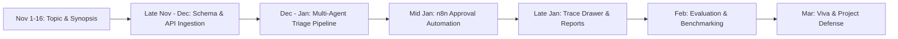

# VAPTLens Agent

> **A Privacy-Preserving Vulnerability Analytics Platform with Multi-Agent AI Triage and Automated Approval Workflows**

[](https://www.jaihindcollege.com)
[](https://www.jaihindcollege.com)
[](LICENSE)
[](#technology-stack)
[](#ai-components-in-detail)

---

## Academic Project Information

- **Student:** Aadish (UID: `24BIT010`)
- **Degree & Semester:** B.Sc. Information Technology, Semester VI
- **Institution:** Jai Hind College (Autonomous), University of Mumbai
- **Project Type:** AI-Based Full-Stack Web Application
- **Pillars Covered:** Agentic AI, Generative AI (Multi-LLM), Prompt Engineering & Evaluation, Workflow Automation (n8n)
- **Key Milestones:** Topic Approval (1 Nov 2026), Synopsis Submission (16 Nov 2026), Mid-term Review (Jan 2027), Final Viva (Mar 2027)

---

## 1. Executive Summary

Vulnerability scanners (Nessus, OpenVAS, Qualys, Burp Suite, OWASP ZAP, Nuclei) produce extensive reports with hundreds or thousands of findings. Security teams spend disproportionate effort on repetitive manual tasks: de-duplicating findings across scanners, figuring out real business risk, drafting remediation tickets, and waiting for approvals across emails and ad-hoc chat channels.

Building upon the visual analytics foundation of VAPTLens, **VAPTLens Agent** transforms the dashboard into an **autonomous security reasoning system**. It ingests raw scan outputs, strips and redacts sensitive internal network topology in the browser, orchestrates a multi-agent AI pipeline to triage and verify vulnerabilities against NVD ground truth, and triggers automated, explainable approval workflows via Dockerized **n8n**.

> **Core Philosophy:** *Not just an application that calls an LLM. A deterministic, explainable system that reasons, uses verification tools, automates approval lifecycles, and enforces privacy by design.*

---

## 2. Problem Statement

1. **Information Overload & Duplication:** Heterogeneous scan reports bury critical security flaws under duplicate and low-severity noise.
2. **Context-Blind Prioritization:** Raw CVSS v3/v4 scores do not account for contextual exposure (public-facing vs. internal, data classification, reachability).
3. **Remediation Bottlenecks:** Security engineers spend hours drafting repetitive fix recommendations and issue tickets manually.
4. **Unstructured Approvals:** Critical findings and accepted risks linger in email threads without an immutable audit trail or sign-off history.
5. **Privacy & Data Sovereignty Risk:** Uploading raw security scan exports to third-party cloud LLMs leaks internal IPs, domain names, usernames, and server architecture.
6. **Hallucination in High-Stakes Security:** LLMs frequently invent non-existent CVE IDs, fabricate patch advice, or misquote CVSS vectors when ungrounded.

---

## 3. Project Objectives

1. **Unified Normalization:** Ingest and normalize scan reports from 5+ scanners (CSV, XML, JSON) into a strict, unified security finding schema.
2. **Privacy by Default:** Ensure raw scan data is parsed locally in the browser; enforce client-side pseudonymization/redaction before any finding reaches the server or AI models.
3. **Multi-Agent Triage Pipeline:** Architect a 4-agent collaborative pipeline (Enrichment, Prioritizer, Remediation, Evaluator) following a *Plan → Act → Evaluate → Revise* paradigm.
4. **Hallucination Elimination:** Ground AI outputs against authoritative NVD CVE metadata and implement cross-model evaluation to reject hallucinations and enforce explicit abstention (`insufficient_data`).
5. **Workflow Automation with n8n:** Automate manager approvals, Jira/GitHub ticketing, escalation, and retesting via signed n8n webhooks.
6. **Full Decision Explainability:** Provide an interactive reasoning trace drawer displaying every prompt, agent deliberation step, verifier score, and model call.

---

## 4. Scope

| Dimension | In Scope | Out of Scope |
|---|---|---|
| **Input Data** | CSV, XML, JSON imports from Nessus, OpenVAS, ZAP, Burp Suite, Nuclei | Executing live network/web penetration scans |
| **AI Capabilities** | Multi-agent triage, CVE grounding, risk scoring, remediation drafting, adversarial verification | Training custom foundational LLM models from scratch |
| **Automation** | Multi-step approval workflows, signed expiring tokens, ticketing webhooks, retest scheduling | Automatic zero-click server patching or exploit firing |
| **Platforms** | Responsive modern web application (Desktop & Tablet) | Native mobile applications (iOS/Android) |
| **Access Control** | Role-Based Access Control (Analyst, Manager, Administrator) with session authentication | Enterprise SAML/SSO federation (future scope) |

---

## 5. System Architecture

```
                             Browser (React 18 + TypeScript + Vite)
 ┌─────────────────────────────────────────────────────────────────────────────────────────────┐
 │  1. Upload Scan (CSV / XML / JSON)  ──►  Parse (PapaParse / DOMParser)                     │
 │  2. Local-Only Analytics Engine (Zero telemetry, 100% in-browser)                           │
 │  3. [Opt-In Triage] Redaction Engine: Replace IPs/Hosts/Emails with stable pseudonyms       │
 │     e.g., 192.168.1.42 ➔ HOST-A3F2, db.corp.internal ➔ ASSET-9B11                          │
 └──────────────────────────────────────────────┬──────────────────────────────────────────────┘
                                                │ HTTPS POST (Redacted findings only)
                                       ┌────────▼────────┐
                                       │  Nginx Reverse  │
                                       │  Proxy (CSP)    │
                                       └────────┬────────┘
                                                │
 ┌──────────────────────────────────────────────▼──────────────────────────────────────────────┐
 │                                Node.js REST API Backend                                     │
 │  • Session Auth (scrypt)   • Scans & Findings Store   • Redaction Verification Gate         │
 │  • Audit Log Chaining      • Report Engine            • Signed n8n Webhook Dispatcher       │
 └─────────────┬────────────────────────────────┬───────────────────────────────┬──────────────┘
               │                                │                               │
     ┌─────────▼────────┐             ┌─────────▼──────────┐          ┌─────────▼──────────┐
     │   PostgreSQL 16  │             │ Multi-Agent Engine │          │    n8n Workflow    │
     │  Relational DB   │             │   Orchestrator     │          │    (Dockerized)    │
     └──────────────────┘             └─────────┬──────────┘          └─────────┬──────────┘
                                                │                               │
                               ┌────────────────┴───────────────┐               │
                               │  LLM Layer & External Grounding │               ├─► Manager Email
                               │  • Claude (Anthropic)          │               │   (Signed Link)
                               │  • Gemini (Google DeepMind)    │               ├─► Ticket Creation
                               │  • GPT-4o (OpenAI)             │               │   (GitHub/Jira)
                               │  • NVD REST API & Local Cache  │               └─► Retest Trigger
                               └────────────────────────────────┘
```

### Architectural Principles
- **Privacy by Default:** Raw scan uploads are parsed locally. Server triage is opt-in and operates solely on pseudonymized records.
- **Provider-Agnostic LLM Adapter:** Unified `generate(prompt, schema, provider)` interface with automatic retry and cross-provider fallback.
- **Explainability First:** Every agent deliberation, prompt token count, and evaluator check is persisted in `agent_runs` and visualized.
- **Human in the Loop:** Critical remediation actions and risk acceptances require cryptographic manager approval.

---

## 6. Core Modules

### 6.1 Main Modules

#### Module 1: Scan Ingestion, Normalization & Client-Side Redaction Engine
- **Heuristic Auto-Detection:** Automatically detects scanner origin based on headers, XML namespaces, and JSON keys (Nessus, OpenVAS, Burp, ZAP, Nuclei).
- **Canonical Schema Mapping:** Standardizes disparate titles, severities, CVSS scores, CVE identifiers, endpoints, and solutions.
- **Client-Side Redaction:** Scans hostnames, private IPs (RFC 1918), public IPs, internal URLs, and user accounts. Replaces them with deterministic session-stable tokens (`HOST-xxxx`, `NET-xxxx`, `USER-xxxx`). The real-to-pseudonym lookup table never leaves the user's browser.
- **Cross-Scan De-duplication:** Automatically identifies identical vulnerabilities across overlapping scanner outputs using composite hash keys `(cve_id, asset_ref, port, service)`.

#### Module 2: Multi-Agent AI Triage Pipeline
An autonomous multi-agent pipeline following the **Plan → Act → Evaluate → Revise** paradigm:

| Agent | Responsibilities | Grounding Tools | Primary Output |
|---|---|---|---|
| **Enrichment Agent** | Verifies CVE validity, fetches CVSS v3.1 vector, EPSS score, and CISA KEV status | NVD API v2, CISA KEV cache, Local CVE store | Enriched CVE metadata & exploit status |
| **Prioritizer Agent** | Computes contextual risk using asset sensitivity, external exposure, and exploitability | Asset metadata, CVSS metrics, SSVC decision tree | Contextual Risk Score (1-100) + Rationale |
| **Remediation Agent** | Drafts concrete, step-by-step fix instructions and ticket descriptions | LLM Generator (e.g. Gemini 1.5 Pro / GPT-4o) | Structured JSON remediation plan |
| **Evaluator Agent** | Adversarially verifies output for hallucinations, invalid CVEs, and mismatched fixes | Second Independent Model + NVD Database validation | `PASS`, `FAIL`, or `REVISE` with line-item critique |

- **Feedback & Revision Loop:** When the Evaluator flags a hallucinated CVE or invalid recommendation, the Remediation Agent retries with specific critique (maximum 2 retries). Findings failing verification are marked `needs_human_review`.
- **Abstention Policy:** The system prioritizes saying *"insufficient data"* over fabricating security steps.

#### Module 3: n8n Approval Workflow Automation
Containerized n8n service providing visual, transparent, and auditable automation:
- **Workflow A (Critical Approval):** API fires a signed webhook for critical findings. n8n sends an HTML notification to the reporting manager containing the AI reasoning summary and cryptographically signed single-use *Approve* and *Reject* links.
- **Workflow B (Escalation):** If an approval link remains unclicked after 24 hours, n8n sends a reminder and automatically escalates to a secondary approver.
- **Workflow C (Retest Lifecycle):** Once a remediation deadline approaches, n8n notifies the analyst to trigger a re-scan and automatically correlates new scan uploads to mark findings `Resolved` or `Still Open`.

---

### 6.2 Basic / Supporting Modules

- **Module 4: Interactive Analytics Dashboard:** Real-time metrics, risk distribution, scanner comparison charts, customizable layout, and an expandable finding drawer displaying the complete **agent reasoning trace**.
- **Module 5: Role-Based Access Control (RBAC) & Audit:** Analyst, Manager, and Administrator roles with scrypt password hashing, rate limiting, and an immutable SHA-256 chained audit log.
- **Module 6: Report Generation Engine:** Client-side generation of comprehensive executive and technical PDF/CSV/Word reports, preserving data confidentiality.
- **Module 7: Notification Center & Retest Scheduler:** In-app status center tracking approval requests, scheduled re-tests, and system events.

---

## 7. AI Components & Evaluation Methodology

### 7.1 Multi-LLM Provider Architecture
Unified provider adapter supporting:
- **Google Gemini API:** Fast, cost-efficient bulk ingestion and enrichment summaries.
- **Anthropic Claude API & OpenAI API:** High-precision remediation drafting and cross-model evaluation.
- **Cross-Model Verification:** Generator model (e.g., Provider A) is strictly audited by a different verifier model (e.g., Provider B) to break shared hallucination modes.

### 7.2 Prompt Engineering & Hallucination Reduction Framework
The academic core of the project includes a formal benchmarking experiment evaluating prompt strategies across a fixed corpus of labeled findings:

| Strategy | Prompt Design Technique | Hypothesized Error Reduction |
|---|---|---|
| **T0: Zero-Shot Direct** | Baseline instruction without context | High hallucination rate (baseline) |
| **T1: Few-Shot In-Context** | Injected with 3 verified CVE/fix pairs | Moderate improvement in format and terminology |
| **T2: Role & System Prompting** | Persona-constrained expert prompt | Improved tone, slight reduction in false positives |
| **T3: Grounded Context (RAG)** | Injects verified NVD/CISA metadata into context | Drastic drop in fabricated CVE IDs |
| **T4: Strict JSON Schema** | Enforces structured output schema validation | Zero structural errors; eliminates parsing failures |
| **T5: Explicit Abstention** | Instructions to return `insufficient_data` if confidence < 80% | Eliminates speculative security advice |
| **T6: Dual-Model Verification** | Secondary independent model verification pass | Lowest net error rate across all categories |

> **Evaluation Metric:** Hallucinated CVE Rate (%), Inaccurate Remediation Rate (%), and Explicit Abstention Rate (%) measured across 200 ground-truth findings.

---

## 8. Database Schema (PostgreSQL)

```
┌──────────────────┐       ┌──────────────────┐       ┌──────────────────┐
│      users       │       │      scans       │       │     findings     │
├──────────────────┤       ├──────────────────┤       ├──────────────────┤
│ id (PK)          │1     *│ id (PK)          │1     *│ id (PK)          │
│ email            ├───────┤ user_id (FK)     ├───────┤ scan_id (FK)     │
│ password_hash    │       │ scanner          │       │ title            │
│ role             │       │ uploaded_at      │       │ severity         │
│ created_at       │       │ finding_count    │       │ cvss             │
└─────────┬────────┘       └──────────────────┘       │ cve_ids (ARRAY)  │
          │                                           │ asset_ref (Anon) │
          │                                           │ status           │
          │                                           └────────┬─────────┘
          │                                                    │
          │         ┌──────────────────┐                       │
          │         │  triage_results  │                       │
          │         ├──────────────────┤                       │
          │         │ id (PK)          │                       │
          │         │ finding_id (FK)  ├───────────────────────┤
          │         │ risk_score       │                       │
          │         │ remediation_json │                       │
          │         │ verified (BOOL)  │                       │
          │         │ needs_review     │                       │
          │         └──────────────────┘                       │
          │                                                    │
          │         ┌──────────────────┐                       │
          │         │    agent_runs    │                       │
          │         ├──────────────────┤                       │
          │         │ id (PK)          │                       │
          │         │ finding_id (FK)  ├───────────────────────┤
          │         │ agent_name       │                       │
          │         │ provider, model  │                       │
          │         │ prompt, response │                       │
          │         │ passed (BOOL)    │                       │
          │         └──────────────────┘                       │
          │                                                    │
          │1        ┌──────────────────┐                       │
          └─────────┤    approvals     │                       │
                   *├──────────────────┤                       │
                    │ id (PK)          │                       │
                    │ finding_id (FK)  ├───────────────────────┘
                    │ approver_id (FK) │
                    │ decision, reason │
                    │ token_hash       │
                    │ decided_at       │
                    └──────────────────┘
```

---

## 9. Technology Stack

| Layer | Technologies |
|---|---|
| **Frontend UI** | React 18, TypeScript, Vite, Tailwind CSS, Radix UI, Lucide Icons, react-grid-layout |
| **Client-Side Processing** | PapaParse, fast-xml-parser, jsPDF, html2canvas, docx, DOMPurify |
| **Backend API** | Node.js 22 LTS, Express / native HTTP, REST, scrypt password hashing |
| **Database** | PostgreSQL 16 (production/Docker) & node:sqlite (local development fallback) |
| **Workflow Automation** | n8n (Docker container, Webhook integrations, signed expiring URLs) |
| **AI & LLM Services** | Anthropic Claude API, Google Gemini API, OpenAI API, NVD REST API v2 |
| **Container & Hosting** | Docker, Docker Compose, Nginx (TLS, CSP `connect-src 'self'`) |
| **Tooling & CI** | Git, GitHub Actions, npm, tsc |

---

## 10. Dataset & Validation Plan

### 10.1 Ground Truth Dataset
- **Sources:** Controlled, authorized vulnerability assessments performed on:
  - OWASP Juice Shop
  - Damn Vulnerable Web Application (DVWA)
  - Metasploitable 2/3
  - Ateion Staging Environment *(strictly with written management authorization)*
- **Tools Used:** OWASP ZAP, Nuclei, OpenVAS / Greenbone, Burp Suite Community.
- **Dataset Size:** 150–300 verified, manually labeled findings covering Web, Network, and Configuration flaws.
- **Ground Truth Labels:** Real severity, validated CVE IDs, verified exploitability status, true/false positive flag, and optimal remediation steps.

### 10.2 Industry Manager Authentication
- In accordance with university requirements, the dataset and workflow are validated in collaboration with a reporting manager/lead at **Ateion**.
- The manager authenticates the labeled dataset samples and participates as the human-in-the-loop approver in the n8n live demonstration.

---

## 11. Quick Start & Setup

### Prerequisites
- Node.js 22+ & npm
- Docker & Docker Compose (optional for full containerized stack)
- Git

### Local Development Setup

1. **Clone the repository:**
   ```bash
   git clone https://github.com/aadish0day/vaptlens-agent.git
   cd vaptlens-agent
   ```

2. **Install dependencies:**
   ```bash
   npm install
   ```

3. **Configure environment:**
   ```bash
   cp .env.example .env
   # Edit .env to supply your LLM API keys (GEMINI_API_KEY, ANTHROPIC_API_KEY, etc.)
   ```

4. **Run the local development stack:**
   ```bash
   # Terminal 1: Start API server (SQLite mode)
   npm run server

   # Terminal 2: Start Vite frontend
   npm run dev
   ```
   Open [http://localhost:5173](http://localhost:5173) in your browser.

5. **Run tests:**
   ```bash
   npm test
   npm run typecheck
   ```

---

## 12. Semester Roadmap



---

## 13. Viva Talking Points & Defense Guide

1. **Why multi-agent instead of a single prompt?**
   Single-prompt LLMs conflate generation and verification. Decomposing into Enrichment, Prioritizer, Remediation, and Evaluator enforces separation of concerns and enables automated retries when verification fails.
2. **How does client-side redaction protect privacy?**
   The browser strips hostnames, private IPs, and credentials and generates deterministic pseudonyms (`HOST-A3F2`). The backend and LLM only ever see the pseudonyms; the translation table remains strictly in the client's memory.
3. **Why n8n for approval workflows?**
   n8n provides visual, auditable, and easily modifiable workflow orchestration with execution histories, preventing vendor lock-in and avoiding hardcoded notification logic in the application.
4. **How is hallucination scientifically measured?**
   Using a 200-finding ground truth corpus, we quantitatively benchmark 7 prompt strategies, recording the hallucinated CVE rate, incorrect remediation rate, and abstention rate.

---

## Author & Academic Credit

- **Author:** Aadish (`@aadish0day`)
- **Institution:** Jai Hind College, Mumbai
- **Course:** TYBSc IT — Semester VI (2026–2027)
- **Repository:** [https://github.com/aadish0day/vaptlens-agent](https://github.com/aadish0day/vaptlens-agent)
